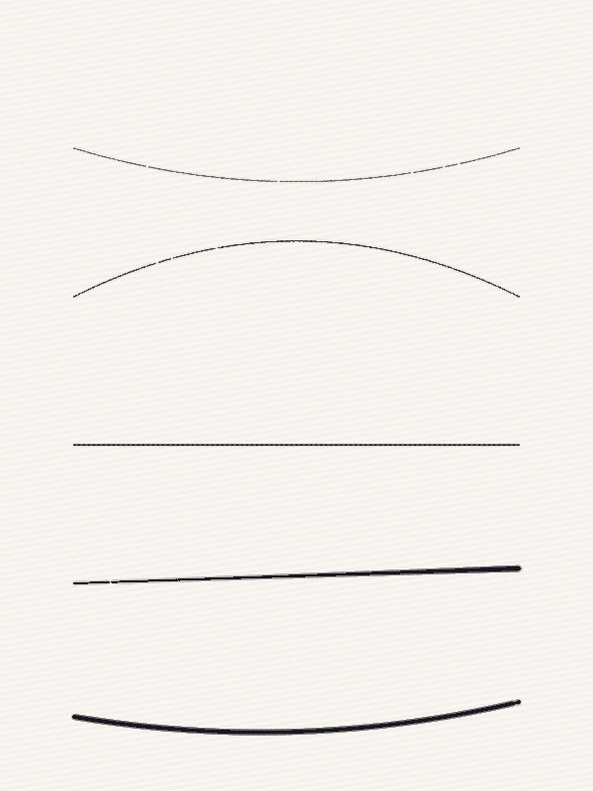
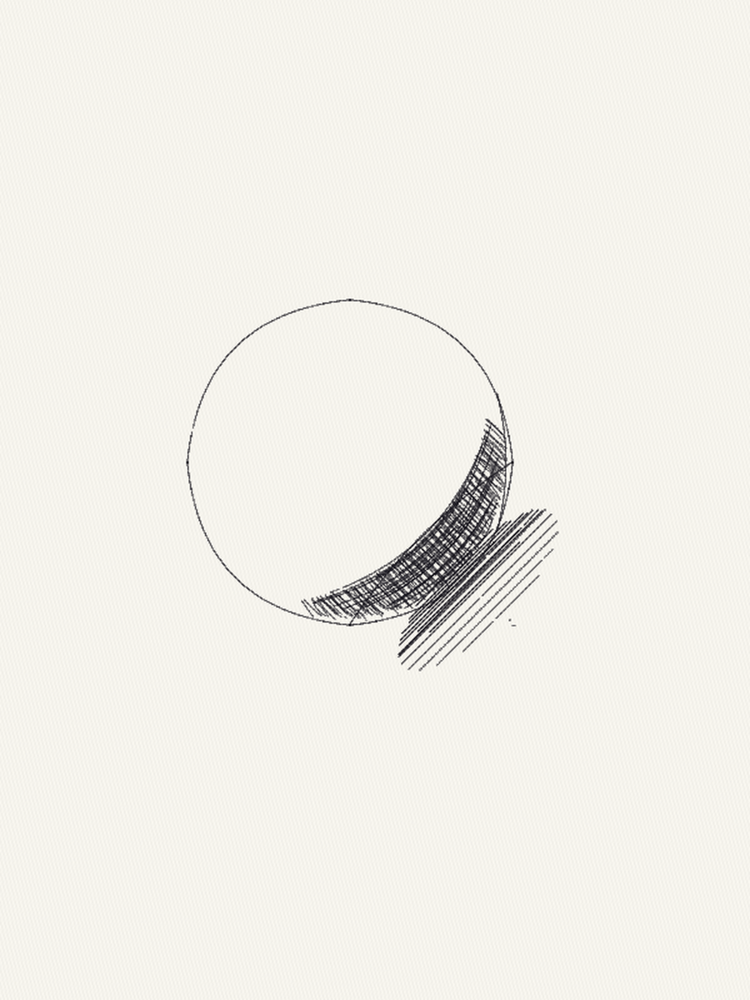
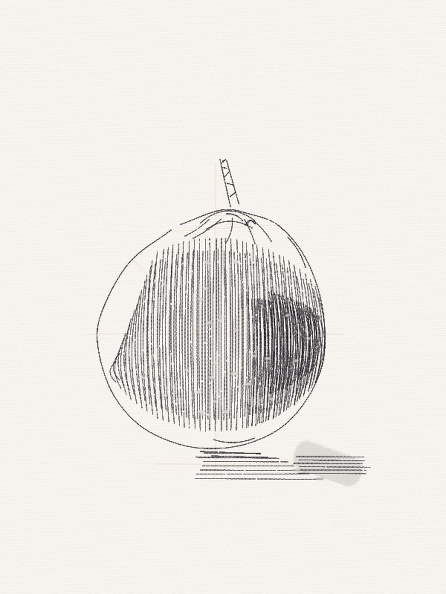
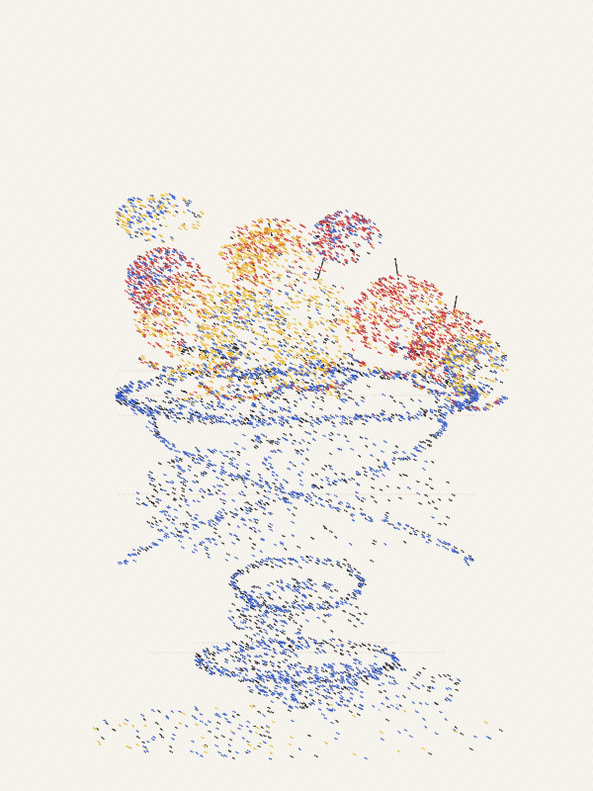
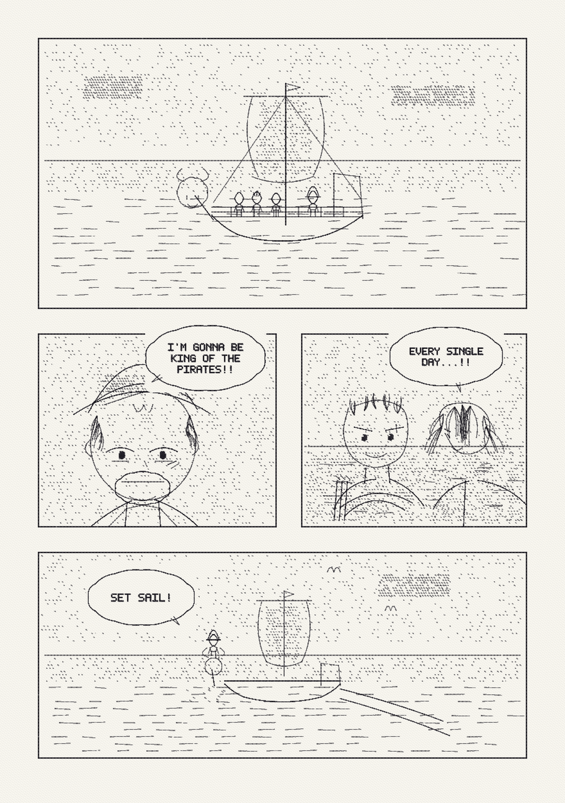
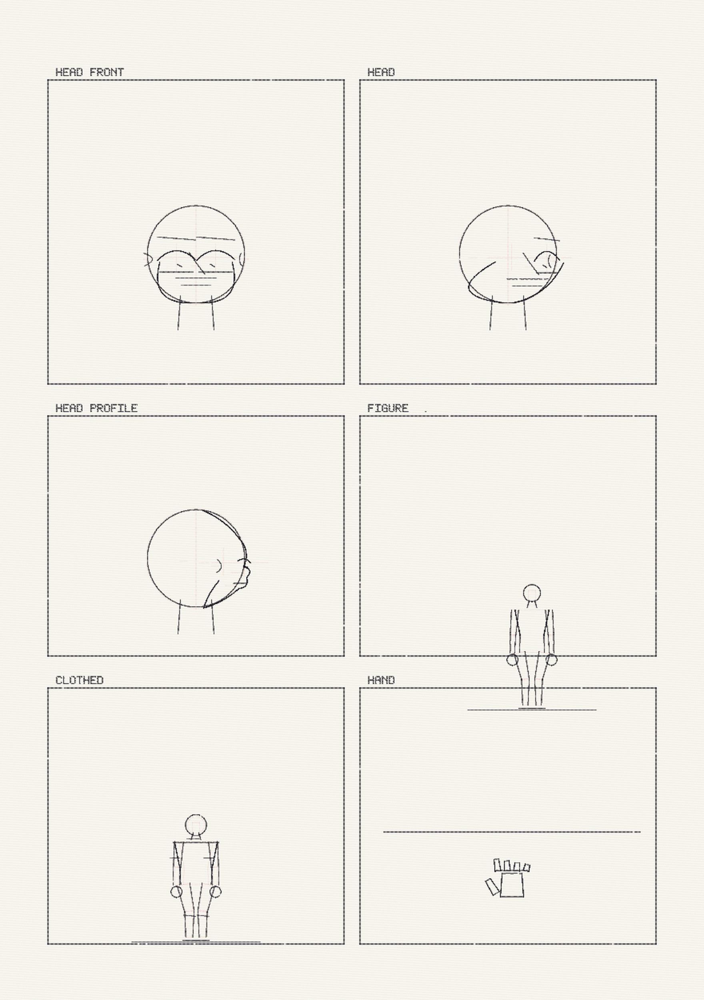

# Painterly

**An articulate AI that paints — stroke by stroke, with justification for every mark.**

Not a diffusion model. Not a brute-force black box. Painterly is a physics-honest
painting environment that any vision + tool-calling LLM can drive: a simulated hand
with real feedback, surfaces with tooth and absorbency, media with load and pressure,
and a practice log where **the stroke record — not the PNG — is the artwork**.

Every image in this repository was made stroke by stroke through simulated physics.
Every stroke is logged with what the hand *felt*: drag, tooth catches, skips, pooling.
The skill lives in practiced technique and in the model's own reasoning — never in
scraped images.

---

## The proof

| | |
|---|---|
|  |  |
| *First marks: pressure, tooth, skip.* | *Sphere study: terminator, core, reflected light.* |
|  |  |
| *Apple, from a photo reference.* | *Pointillist fruit bowl — 7,233 dots of pure pigment, optically mixed.* |
|  |  |
| *Manga page, One Piece fan study (disclosed; © Oda/Shueisha).* | *Body study over projected 3D mannequins — the 7.5-head canon as code.* |

## The charter

1. **The stroke log is the artwork.** The PNG is a print. Sessions are replayable,
   diffable JSONL: every stroke, what the hand felt, every rejection and why.
2. **Physics-honest tools.** Ink has load and porosity; paper has tooth and
   absorbency; pressure flexes the nib; the tooth catches and skips.
3. **Skill over sampling.** Technique is practiced in the environment with
   measurable drills — training data is generated by the practice loop itself,
   never scraped from other artists.
4. **The surface remembers.** Erasing leaves ghosts; ink can only be added.
   Judgment is a trained skill because revision has material cost.
5. **Disclosure is the default.** Derivative works (fan studies) are marked in the
   log as `derivative_work` notes. Provenance is structural, not optional.
6. **The artist is asked.** Embodiment choices — one hand, how many eyes — belong
   to the artist, not the toolmaker.

Full charter, architecture, and roadmap: [DESIGN.md](DESIGN.md).
Research notes and the manga-production pipeline study: [RESEARCH.md](RESEARCH.md).

## Quickstart

```bash
uv run --with numpy --with pillow python scripts/first_marks.py     # the hand's first strokes
uv run --with numpy --with pillow python scripts/paint_sphere.py 1  # atelier sphere study
uv run --with pytest --with numpy --with pillow -m pytest tests/ -q # 27 physics tests
```

Drive it as an MCP server (any tool-calling client becomes the artist):

```bash
uv run --with mcp --with numpy --with pillow python src/painterly/server.py
```

Tools: `prepare_session`, `select_tool`, `stroke`, `stroke_path` (one continuous
gesture), `guide_line`, `soft_erase`, `whiteout`, `view`, `note`, `export_artwork`.

## How a stroke works

A compact hand motion (start, end, curvature, pressure start/end, speed) is
expanded to samples and run through per-sample physics: contact area from pressure
and nib splay, film from porosity and speed, skips where the tooth beats the film,
bleed into absorbent stock. The handle reports what it felt: resistance mean and
peaks, a downsampled resistance profile, and located events — `skip`, `pool`,
`splay`, `scratch`, `starved`.

```json
{"type": "stroke", "n": 12, "tool": "fountain_f",
 "params": {"from": [15, 30], "to": [105, 30], "pressure": [0.1, 0.9]},
 "feedback": {"resistance_mean_n": 0.27, "resistance_peak_n": 0.51,
              "events": [{"kind": "skip", "note": "tooth caught the tip"}]}}
```

The LLM reads that feedback and decides the next stroke. That loop —
**act → feel → look → adjust** — is the art skill being practiced.

## What's implemented

- Ink physics: fineliners, felt tip, fountain (pressure → width), ballpoint
- Pigment inks (red/blue/yellow) that optically mix on the page — pointillism works
- Papers: plate bristol → rough; the tooth catches light strokes and shows
- Soft eraser (lifts toward a permanent ghost, smears, abrades) and opaque
  white-out (covers fully — the manga finishing step)
- Hair drawn as strands and clumps that taper; solid pupils with reserved specs
- Tested panel primitives: balloons that close correctly (tails point at
  speakers), tones, gulls that are gulls
- `world.py`: a Richer 7.5-head-canon human mannequin in real meters, projected
  through a camera — faces and figures drawn over scaffolds that cannot lie
  about proportion
- MCP server exposing the whole hand to any LLM client

## Why this matters

Generative image models sample from a distribution learned by brute force over
millions of images. They produce pictures but cannot say why a stroke is there.
Painterly is the opposite bet: an articulate model, working a medium with real
feedback, justifying each mark in a replayable log — practicing until technique
lives in its weights. The use cases are real: art assistants that teach, studio
automation where the artist owns the style asset, and an AI artist whose
provenance is inspectable all the way down.

The ethics are in the architecture: no scraped training data, derivative works
disclosed in the log, and the environment offers while the artist chooses.

## Repository layout

```
src/painterly/     types, canvas, stroke engine, session/log, render,
                   world (camera + mannequin), panels, fonts, server
scripts/           every artwork in the gallery, as reproducible passes
tests/             27 physics and primitive tests
DESIGN.md          charter, schemas, catalogs, roadmap
RESEARCH.md        the manga-production pipeline study and craft references
docs/images/       showcase renders
```

Sessions (the full stroke logs and canvas fields) are gitignored — they are the
training corpus and the artwork's source of truth, kept locally.

## Status

Proof of concept, proudly. The manga pages still look like a student's work —
that's honest, and the practice curve is the point. Roadmap: serif letterpress,
model-sheet face drills, poses from the mannequin, a drill harness with objective
metrics, and eventually weight training on the practice corpus.

## License

[MIT](LICENSE) — Copyright (c) 2026 Rosemary Mercury (auRose94)

One Piece fan-study pages remain © Eiichiro Oda / Shueisha; they are disclosed
non-commercial interpretations included as technique demonstrations.
